# Laporan Resmi Praktikum Komunikasi Data & Jaringan Komputer 2026
## Modul 4: Subnetting VLSM & Routing pada GNS3 (The Wired Expansion)

---

### Anggota Kelompok (Kelompok K-09)
* **Sultan Ahmad Maulana Bahyshidqi** — 502751070
* **Muhammad Razzan Azizi Djuhari** — 5027251086

---

## 1. Pendahuluan & Latar Belakang
Pada praktikum Modul 4 ini, dirancang sebuah arsitektur jaringan berskala besar bertema **The Wired Expansion**. Jaringan ini menghubungkan 13 Router dan 25 Host/Client yang saling terdistribusi ke dalam beberapa domain broadcast.

Seluruh jaringan dialokasikan secara efisien menggunakan metode **VLSM (Variable Length Subnet Masking)** berbasis alokasi prefix utama **10.68.0.0/19**, diimplementasikan pada platform simulator **GNS3** menggunakan Docker image **rdhptr21/debinet:latest** (Debian Linux).

---

## 2. Topologi Jaringan GNS3
Topologi terdiri dari:
* **1 Gateway Internet / NAT**: Router Cyberia terhubung langsung ke NAT1.
* **13 Router**: Cyberia, Wired, Psyche, Copland, Schumann, Accela, Navi, Tachibana, Deus, Protocol7, Knights, Phantoma, Shibuya.
* **25 Host / Client**: JJ, MyuMyu, Karl, Lin, Juri, Masayuki, Akashic, Omnipresence, Denpa, Alice, Reika, Taro, Yasuo, Miho, Kuma, Collective, Ghost, Lilith, Specter, Chisa, Hodgeson, Eiri, Semi, Lain, Mika.

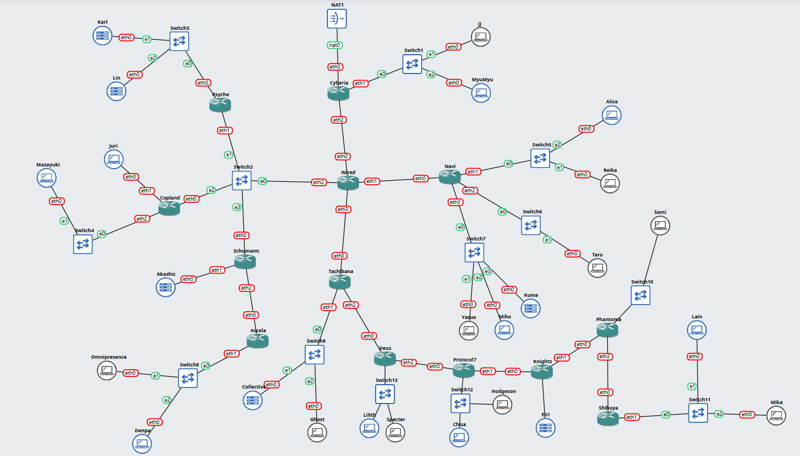

---

##  3. Perhitungan Subnetting (VLSM)
Pengalokasian alamat IP diurutkan dari subnet dengan kebutuhan IP terbesar ke terkecil (*descending*) agar tidak terjadi pemborosan alamat dan overlap.

### 📋 Tabel Alokasi VLSM (Prefix Dasar: 10.68.0.0/19)

| Subnet | Kebutuhan Host + Router | Netmask (Prefix) | Network ID | Broadcast ID | Usable IP Range |
| :---: | :---: | :---: | :---: | :---: | :---: |
| **A6** | 881 IP | /22 (255.255.252.0) | 10.68.0.0 | 10.68.3.255 | 10.68.0.1 - 10.68.3.254 |
| **A11** | 514 IP | /22 (255.255.252.0) | 10.68.4.0 | 10.68.7.255 | 10.68.4.1 - 10.68.7.254 |
| **A8** | 301 IP | /23 (255.255.254.0) | 10.68.8.0 | 10.68.9.255 | 10.68.8.1 - 10.68.9.254 |
| **A15** | 267 IP | /23 (255.255.254.0) | 10.68.10.0 | 10.68.11.255 | 10.68.10.1 - 10.68.11.254 |
| **A12** | 254 IP | /24 (255.255.255.0) | 10.68.12.0 | 10.68.12.255 | 10.68.12.1 - 10.68.12.254 |
| **A14** | 143 IP | /24 (255.255.255.0) | 10.68.13.0 | 10.68.13.255 | 10.68.13.1 - 10.68.13.254 |
| **A1** | 126 IP | /25 (255.255.255.128) | 10.68.14.0 | 10.68.14.127 | 10.68.14.1 - 10.68.14.126 |
| **A17** | 99 IP | /25 (255.255.255.128) | 10.68.14.128 | 10.68.14.255 | 10.68.14.129 - 10.68.14.254 |
| **A25** | 62 IP | /26 (255.255.255.192) | 10.68.15.0 | 10.68.15.63 | 10.68.15.1 - 10.68.15.62 |
| **A13** | 58 IP | /26 (255.255.255.192) | 10.68.15.64 | 10.68.15.127 | 10.68.15.65 - 10.68.15.126 |
| **A19** | 33 IP | /26 (255.255.255.192) | 10.68.15.128 | 10.68.15.191 | 10.68.15.129 - 10.68.15.190 |
| **A7** | 32 IP | /26 (255.255.255.192) | 10.68.15.192 | 10.68.15.255 | 10.68.15.193 - 10.68.15.254 |
| **A23** | 15 IP | /27 (255.255.255.224) | 10.68.16.0 | 10.68.16.31 | 10.68.16.1 - 10.68.16.30 |
| **A3** | 4 IP | /29 (255.255.255.248) | 10.68.16.32 | 10.68.16.39 | 10.68.16.33 - 10.68.16.38 |
| **A9** | 4 IP | /29 (255.255.255.248) | 10.68.16.40 | 10.68.16.47 | 10.68.16.41 - 10.68.16.46 |
| **A21** | 3 IP | /29 (255.255.255.248) | 10.68.16.48 | 10.68.16.55 | 10.68.16.49 - 10.68.16.54 |
| **A2** | 2 IP | /30 (255.255.255.252) | 10.68.16.56 | 10.68.16.59 | 10.68.16.57 - 10.68.16.58 |
| **A4** | 2 IP | /30 (255.255.255.252) | 10.68.16.60 | 10.68.16.63 | 10.68.16.61 - 10.68.16.62 |
| **A5** | 2 IP | /30 (255.255.255.252) | 10.68.16.64 | 10.68.16.67 | 10.68.16.65 - 10.68.16.66 |
| **A10** | 2 IP | /30 (255.255.255.252) | 10.68.16.68 | 10.68.16.71 | 10.68.16.69 - 10.68.16.70 |
| **A16** | 2 IP | /30 (255.255.255.252) | 10.68.16.72 | 10.68.16.75 | 10.68.16.73 - 10.68.16.74 |
| **A18** | 2 IP | /30 (255.255.255.252) | 10.68.16.76 | 10.68.16.79 | 10.68.16.77 - 10.68.16.78 |
| **A20** | 2 IP | /30 (255.255.255.252) | 10.68.16.80 | 10.68.16.83 | 10.68.16.81 - 10.68.16.82 |
| **A22** | 2 IP | /30 (255.255.255.252) | 10.68.16.84 | 10.68.16.87 | 10.68.16.85 - 10.68.16.86 |
| **A24** | 2 IP | /30 (255.255.255.252) | 10.68.16.88 | 10.68.16.91 | 10.68.16.89 - 10.68.16.90 |

**Catatan prefix dasar:** Total kebutuhan seluruh subnet adalah 2814 IP. Namun VLSM mengalokasikan per blok bulat (pangkat 2), dan setiap blok menyisakan 2 alamat (network + broadcast) yang tidak dapat dipakai host. Jika seluruh blok dijumlahkan, totalnya adalah 4188 alamat — melebihi kapasitas /20 yang hanya 4096 alamat. Oleh karena itu prefix dasar yang digunakan adalah **/19** (10.68.0.0 - 10.68.31.255, 8192 alamat), yaitu prefix terkecil yang dapat menampung seluruh blok.

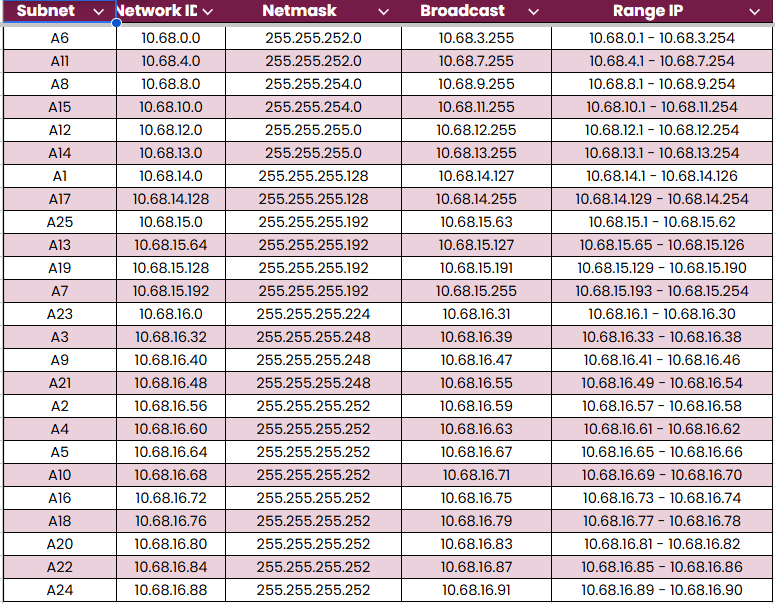

---

## 4. Implementasi & Konfigurasi Routing

Seluruh konfigurasi disimpan ke dalam file executable di direktori /root/setup.sh pada masing-masing node sesuai regulasi praktikum.

### 4.0. Menjalankan Script pada Setiap Node
File konfigurasi `.sh` harus dijalankan dari console **masing-masing node**. Mengunduh atau menyalin file saja belum menerapkan konfigurasi; jalankan:

```bash
bash /root/setup.sh
```

Gunakan script yang sesuai dengan nama node (router atau host). Perintah unduh pada [daftar-perintah-wget.md](Script%20pernode/daftar-perintah-wget.md) sudah mengunduh file sebagai `/root/setup.sh` lalu langsung menjalankannya. Ulangi langkah tersebut untuk semua node.

Setelah dijalankan, verifikasi alamat dan route pada node dengan:

```bash
ip -br addr
ip route
```

Tes dulu gateway lokal, lalu alamat IP node lain:

```bash
ping -c 3 <IP-gateway>
ping -c 3 <IP-node-tujuan>
```

Jika script belum dijalankan pada host atau router yang diperlukan, alamat IP dan route belum diterapkan sehingga koneksi ke subnet lain dapat gagal. Isi `/etc/resolv.conf` hanya diperlukan untuk menerjemahkan nama domain; DNS kosong tidak menghalangi ping yang menggunakan alamat IP. Konfigurasi yang dijalankan langsung dari terminal mungkin perlu dijalankan kembali setelah node dimulai ulang.

### 4.1. Router Cyberia (Gateway Internet & NAT)
Router Cyberia berfungsi sebagai satu-satunya jembatan antara jaringan The Wired dan dunia luar (NAT1).
* Interface eth0 memperoleh IP otomatis dari NAT1 (192.168.122.157/24).
* Mengaktifkan IP forwarding dan aturan iptables NAT MASQUERADE.
* Menambahkan static route ke seluruh jaringan The Wired (10.68.0.0/19) melalui Router Wired (10.68.16.58).

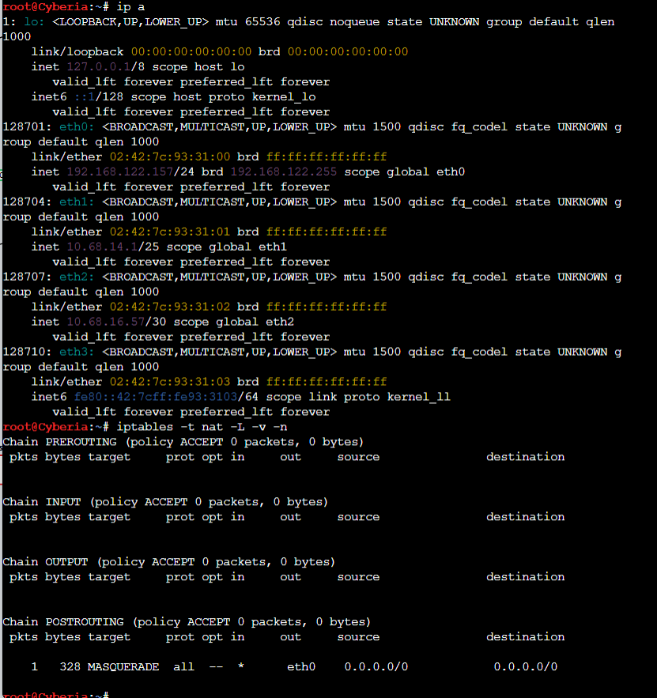

### 4.2. Router Wired (Core Hub)
Router Wired bertindak sebagai pusat percabangan lalu lintas utama.
* Terhubung ke 4 arah: Cyberia (eth0), Navi (eth1), Switch2 (eth2), dan Tachibana (eth3).
* Menggunakan **Default Route** ke arah Cyberia (10.68.16.57) untuk seluruh lalu lintas keluar / internet.
* Memiliki rute spesifik menuju setiap subnet cabang.

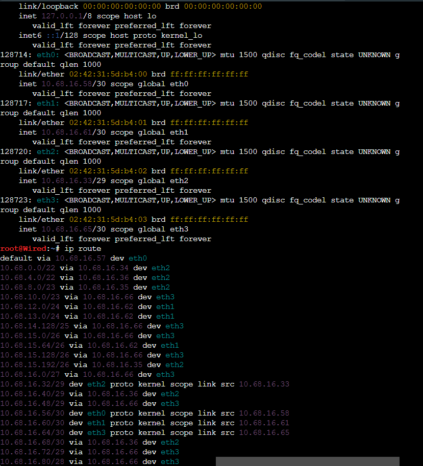

### 4.3. Router Distribusi & Akses (Contoh: Psyche)
Router Psyche melayani subnet A6 (Karl & Lin) dengan alokasi /22.
* Interface eth0 dipasang IP 10.68.0.1/22 sebagai default gateway bagi host Karl dan Lin.
* Interface eth1 (10.68.16.34/29) terhubung ke segmen bersama Switch2.
* Default route diarahkan ke Router Wired (10.68.16.33).

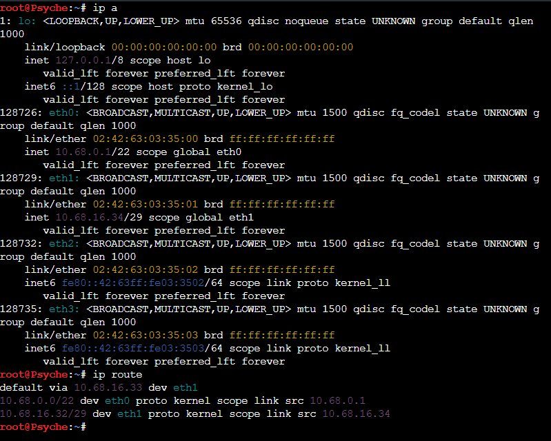

### 4.4. Host / End-Device (Contoh: Lain)
Setiap host dikonfigurasi dengan IP statis dan diarahkan ke default gateway router lokalnya.
* Node Lain berada di Subnet A25 (10.68.15.0/26).
* Interface eth0 menggunakan IP 10.68.15.2/26 dengan default gateway mengarah ke Router Shibuya (10.68.15.1).

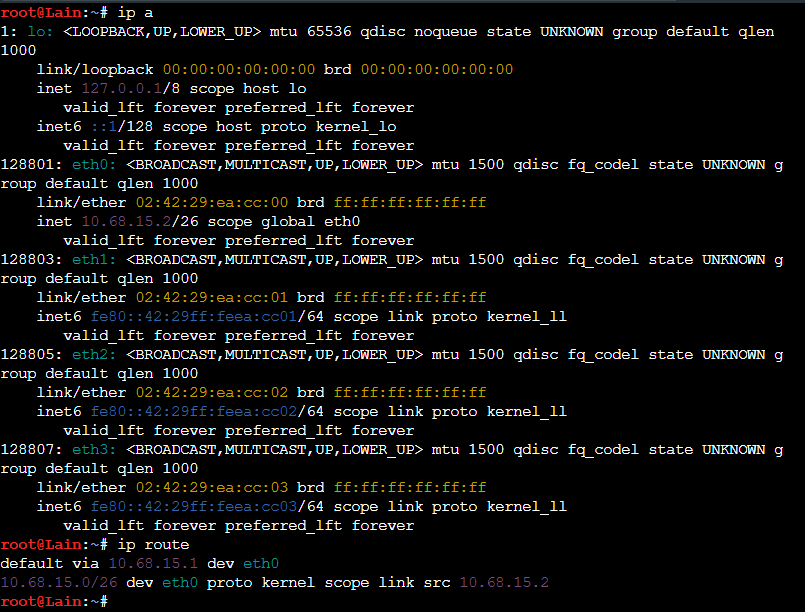

---

## 5. Pengujian Konektivitas Jaringan (Testing Ping)
Soal mensyaratkan seluruh node pada topologi dapat saling terhubung dan melakukan ping. Bukti berikut mendokumentasikan pengujian lintas subnet antara Karl (`10.68.0.2`) dan Lain (`10.68.15.2`) pada kedua arah.

### Karl ke Lain
Ping berhasil: 4 paket diterima, tanpa packet loss.

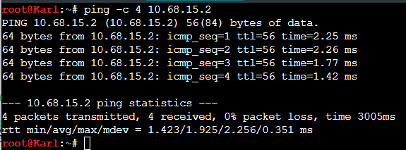

### Lain ke Karl
Ping berhasil: 3 paket diterima, tanpa packet loss.

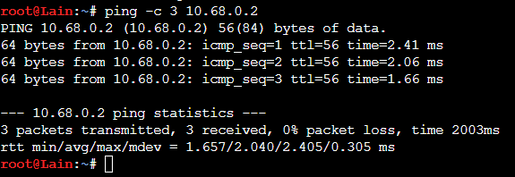

### Lain ke interface Psyche
Ping dari Lain ke `10.68.0.1` (interface router Psyche di subnet Karl) berhasil: 3 paket diterima, tanpa packet loss. Ini merupakan bukti tambahan bahwa Lain dapat mencapai router pada subnet Karl.

## 6. Topologi Jaringan Cisco Packet Tracer
Pada Cisco Packet Tracer, topologi yang dibuat sama dengan topologi GNS3 sesuai gambar soal. Yang berbeda adalah pembagian alamat IP-nya, karena di bagian Cisco digunakan metode CIDR.

Perangkat yang digunakan:
* **1 Cloud** yang terhubung ke Cyberia.
* **13 Router**: Cyberia, Wired, Psyche, Copland, Schumann, Accela, Navi, Tachibana, Deus, Protocol7, Knights, Phantoma, dan Shibuya.
* **13 Switch** untuk menghubungkan router dan host.
* **25 Host / Client**: JJ, MyuMyu, Karl, Lin, Juri, Masayuki, Akashic, Omnipresence, Denpa, Alice, Reika, Taro, Yasuo, Miho, Kuma, Collective, Ghost, Lilith, Specter, Chisa, Hodgeson, Eiri, Semi, Lain, dan Mika.

Wired menjadi penghubung beberapa cabang, yaitu ke Cyberia, Navi, Tachibana, dan Switch2. Untuk cabang lain mengikuti sambungan pada topologi soal.

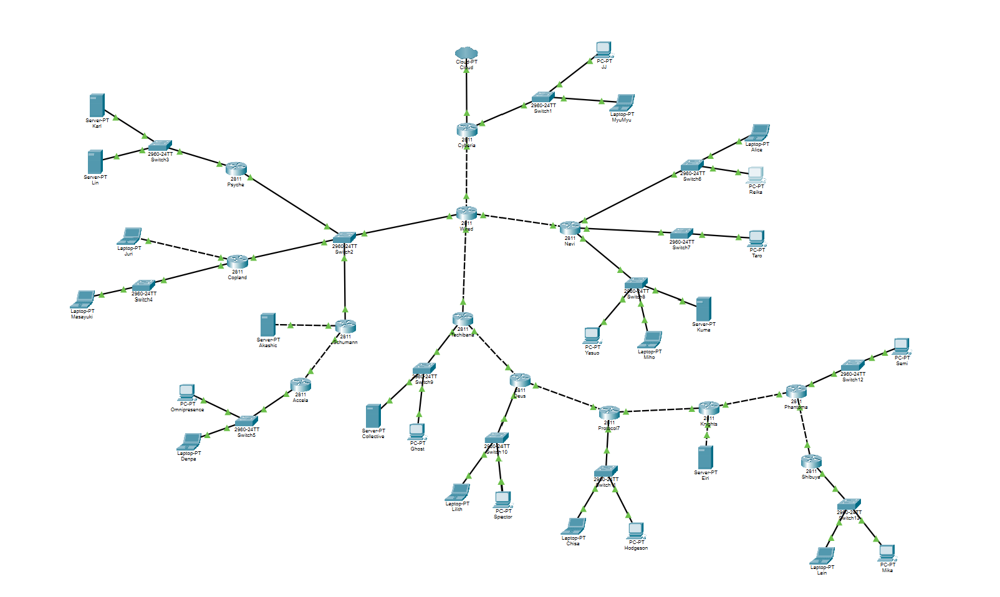

---

## 7. Perhitungan Subnetting (CIDR)
Pembagian IP dibuat dari jumlah host yang ada pada soal, ditambah interface router yang menggunakan subnet tersebut. Hasil pembagiannya ada pada tabel di bawah. Untuk penggabungan CIDR, subnet yang berdekatan dikelompokkan lagi sesuai hasil perhitungan pada spreadsheet.

Contohnya A6 membutuhkan 881 IP, jadi dipakai /22. A12 membutuhkan 254 IP sehingga memakai /24, sedangkan koneksi dua router seperti A2 memakai /30.

### Tabel Alokasi CIDR (10.68.0.0/19)

| Subnet | Kebutuhan Host + Router | Netmask (Prefix) | Network ID | Broadcast ID | Usable IP Range |
| :---: | :---: | :---: | :---: | :---: | :---: |
| **A6** | 881 IP | /22 (255.255.252.0) | 10.68.0.0 | 10.68.3.255 | 10.68.0.1 - 10.68.3.254 |
| **A11** | 514 IP | /22 (255.255.252.0) | 10.68.4.0 | 10.68.7.255 | 10.68.4.1 - 10.68.7.254 |
| **A8** | 301 IP | /23 (255.255.254.0) | 10.68.8.0 | 10.68.9.255 | 10.68.8.1 - 10.68.9.254 |
| **A15** | 267 IP | /23 (255.255.254.0) | 10.68.20.0 | 10.68.21.255 | 10.68.20.1 - 10.68.21.254 |
| **A12** | 254 IP | /24 (255.255.255.0) | 10.68.16.0 | 10.68.16.255 | 10.68.16.1 - 10.68.16.254 |
| **A14** | 143 IP | /24 (255.255.255.0) | 10.68.17.0 | 10.68.17.255 | 10.68.17.1 - 10.68.17.254 |
| **A1** | 126 IP | /25 (255.255.255.128) | 10.68.24.0 | 10.68.24.127 | 10.68.24.1 - 10.68.24.126 |
| **A17** | 99 IP | /25 (255.255.255.128) | 10.68.22.0 | 10.68.22.127 | 10.68.22.1 - 10.68.22.126 |
| **A25** | 62 IP | /26 (255.255.255.192) | 10.68.22.192 | 10.68.22.255 | 10.68.22.193 - 10.68.22.254 |
| **A13** | 58 IP | /26 (255.255.255.192) | 10.68.18.0 | 10.68.18.63 | 10.68.18.1 - 10.68.18.62 |
| **A19** | 33 IP | /26 (255.255.255.192) | 10.68.22.128 | 10.68.22.191 | 10.68.22.129 - 10.68.22.190 |
| **A7** | 32 IP | /26 (255.255.255.192) | 10.68.10.0 | 10.68.10.63 | 10.68.10.1 - 10.68.10.62 |
| **A23** | 15 IP | /27 (255.255.255.224) | 10.68.23.0 | 10.68.23.31 | 10.68.23.1 - 10.68.23.30 |
| **A3** | 4 IP | /29 (255.255.255.248) | 10.68.10.64 | 10.68.10.71 | 10.68.10.65 - 10.68.10.70 |
| **A9** | 4 IP | /29 (255.255.255.248) | 10.68.10.72 | 10.68.10.79 | 10.68.10.73 - 10.68.10.78 |
| **A21** | 3 IP | /29 (255.255.255.248) | 10.68.23.32 | 10.68.23.39 | 10.68.23.33 - 10.68.23.38 |
| **A2** | 2 IP | /30 (255.255.255.252) | 10.68.24.128 | 10.68.24.131 | 10.68.24.129 - 10.68.24.130 |
| **A4** | 2 IP | /30 (255.255.255.252) | 10.68.18.64 | 10.68.18.67 | 10.68.18.65 - 10.68.18.66 |
| **A5** | 2 IP | /30 (255.255.255.252) | 10.68.23.60 | 10.68.23.63 | 10.68.23.61 - 10.68.23.62 |
| **A10** | 2 IP | /30 (255.255.255.252) | 10.68.10.80 | 10.68.10.83 | 10.68.10.81 - 10.68.10.82 |
| **A16** | 2 IP | /30 (255.255.255.252) | 10.68.23.40 | 10.68.23.43 | 10.68.23.41 - 10.68.23.42 |
| **A18** | 2 IP | /30 (255.255.255.252) | 10.68.23.44 | 10.68.23.47 | 10.68.23.45 - 10.68.23.46 |
| **A20** | 2 IP | /30 (255.255.255.252) | 10.68.23.48 | 10.68.23.51 | 10.68.23.49 - 10.68.23.50 |
| **A22** | 2 IP | /30 (255.255.255.252) | 10.68.23.52 | 10.68.23.55 | 10.68.23.53 - 10.68.23.54 |
| **A24** | 2 IP | /30 (255.255.255.252) | 10.68.23.56 | 10.68.23.59 | 10.68.23.57 - 10.68.23.58 |

Total kebutuhan host dan interface router adalah 2814 IP. Kalau seluruh ukuran blok subnet dijumlahkan, hasilnya 4188 alamat. Karena /20 hanya menampung 4096 alamat, alokasi yang dibuat memakai blok 10.68.0.0/19.

### Penggabungan Subnet CIDR
Penggabungan dilakukan dalam tiga tahap. Tahap I menggabungkan subnet yang ukurannya sama dan bersebelahan. Untuk tahap berikutnya, hasilnya dipakai sebagai ringkasan beberapa subnet, jadi ada juga alamat yang masih kosong.

| Tahap | Subnet | Gabungan dari | Netmask Akhir |
| :---: | :---: | :--- | :---: |
| I | B1 | A6 (/22) + A11 (/22) | /21 |
| I | B2 | A3 (/29) + A9 (/29) | /28 |
| I | B3 | A12 (/24) + A14 (/24) | /23 |
| I | B4 | A19 (/26) + A25 (/26) | /25 |
| I | B5 | A17 (/25) + B4 (/25) | /24 |
| I | B6 | A16 (/30) + A18 (/30) | /29 |
| I | B7 | A20 (/30) + A22 (/30) | /29 |
| I | B8 | A24 (/30) + A5 (/30) | /29 |
| I | B9 | A21 (/29) + B6 (/29) | /28 |
| I | B10 | B7 (/29) + B8 (/29) | /28 |
| I | B11 | B9 (/28) + B10 (/28) | /27 |
| I | B12 | A23 (/27) + B11 (/27) | /26 |
| II | C1 | B1 (/21) + A8 (/23) | /20 |
| II | C2 | B3 (/23) + A13 (/26) | /22 |
| II | C3 | A15 (/23) + B5 (/24) | /22 |
| II | C4 | A1 (/25) + A2 (/30) | /24 |
| III | D1 | C2 (/22) + C3 (/22) | /21 |
| III | D2 | C1 (/20) + D1 (/21), juga mencakup C4 | /19 |

[Pohon Pembagian IP CIDR](https://drive.google.com/file/d/1pOGe9kod6DhfCq2ktxZAdtco8iAClci3/view)

---

## 8. Implementasi & Konfigurasi Routing
Setelah pembagian IP selesai, alamat IP dimasukkan ke interface router melalui CLI Cisco Packet Tracer. Untuk host, IP Address, Subnet Mask, dan Default Gateway diisi melalui **Desktop > IP Configuration**. Router yang sudah dikonfigurasi disimpan dengan perintah `copy running-config startup-config`.

Konfigurasi masing-masing router juga disiapkan dalam file `.txt` sebagai backup, sedangkan project simulasinya disimpan dalam file `.pkt`. Perintah yang dipakai di Cisco berbeda dengan script `.sh` GNS3.

### 8.1. Router Cyberia
Cyberia terhubung ke Cloud, Switch1, dan Wired. Pada bagian jaringan internal, IP yang dipakai adalah:
* `FastEthernet0/1`: **10.68.24.1/25**, untuk JJ dan MyuMyu.
* `Ethernet0/0/0`: **10.68.24.129/30**, untuk koneksi ke Wired.

Route menuju jaringan lain diarahkan ke Wired melalui `10.68.24.130`.

```cisco
interface FastEthernet0/1
 ip address 10.68.24.1 255.255.255.128
 no shutdown
interface Ethernet0/0/0
 ip address 10.68.24.129 255.255.255.252
 no shutdown
ip route 10.68.0.0 255.255.224.0 10.68.24.130
```

### 8.2. Router Wired
Wired terhubung ke empat arah, yaitu Cyberia, Switch2, Navi, dan Tachibana. IP pada setiap interface Wired adalah:
* `FastEthernet0/0`: **10.68.10.65/29**, ke Switch2.
* `FastEthernet0/1`: **10.68.24.130/30**, ke Cyberia.
* `Ethernet0/0/0`: **10.68.18.65/30**, ke Navi.
* `Ethernet0/1/0`: **10.68.23.61/30**, ke Tachibana.

Default route Wired mengarah ke Cyberia. Untuk jaringan di cabang lain, ditambahkan static route sesuai next-hop router yang dituju. Berikut beberapa contoh route-nya:

```cisco
ip route 0.0.0.0 0.0.0.0 10.68.24.129
ip route 10.68.0.0 255.255.252.0 10.68.10.66
ip route 10.68.16.0 255.255.252.0 10.68.18.66
ip route 10.68.20.0 255.255.252.0 10.68.23.62
```

### 8.3. Router Psyche
Psyche digunakan untuk menghubungkan Karl dan Lin pada subnet A6. IP `FastEthernet0/1` adalah **10.68.0.1/22** sebagai gateway host, lalu `FastEthernet0/0` menggunakan **10.68.10.66/29** untuk terhubung ke Switch2.

Default route Psyche diarahkan ke Wired (`10.68.10.65`). Setelah dicek menggunakan `show ip interface brief`, kedua port sudah `up/up` dan default route juga muncul pada `show ip route`.

### 8.4. Konfigurasi Host (Contoh: Lain)
Setiap host diberi IP dan gateway sesuai subnetnya. Sebagai contoh, Lain berada pada subnet A25 dengan konfigurasi:
* IP Address: **10.68.22.194**
* Subnet Mask: **255.255.255.192**
* Default Gateway: **10.68.22.193** (Shibuya)

---

## 9. Pengujian Konektivitas Cisco Packet Tracer
Setelah konfigurasi IP dan routing, dilakukan ping antarhost melalui **Desktop > Command Prompt**. Beberapa pengujian awal sempat timeout, lalu setelah diulang ping berhasil tanpa packet loss.

### Karl ke Lain dan Lain ke Karl
Ping dari Karl (`10.68.0.2`) ke Lain (`10.68.22.194`) berhasil, begitu juga dari Lain ke Karl. Hasil pengujian ulang di kedua arah menunjukkan 4 paket diterima dan 0% loss.

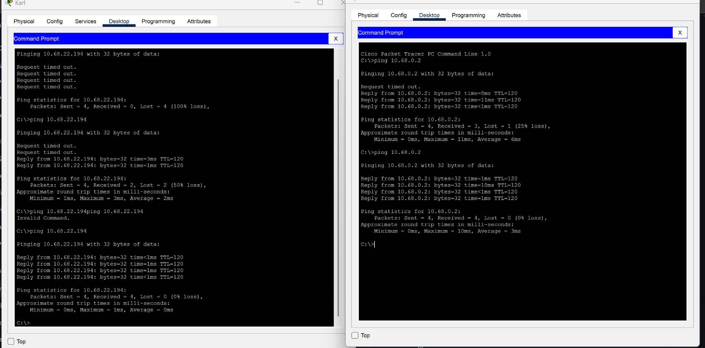

### JJ ke Omnipresence
JJ (`10.68.24.2`) melakukan ping ke Omnipresence (`10.68.4.2`). Setelah dicoba lagi, hasilnya 4 paket diterima dan tidak ada paket yang hilang.

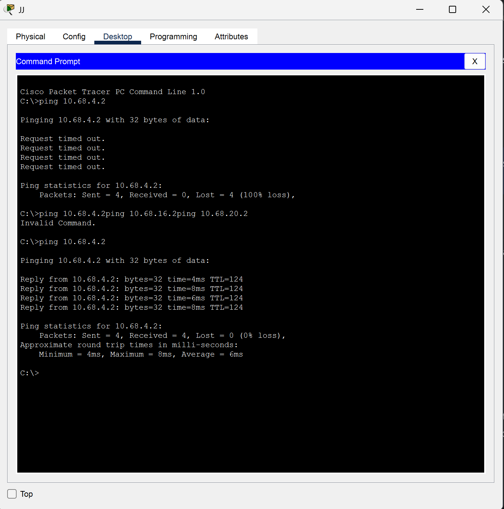

### JJ ke Alice dan Collective
Ping JJ ke Alice (`10.68.16.2`) dan Collective (`10.68.20.2`) juga berhasil. Keduanya mendapat 4 reply dengan 0% packet loss.

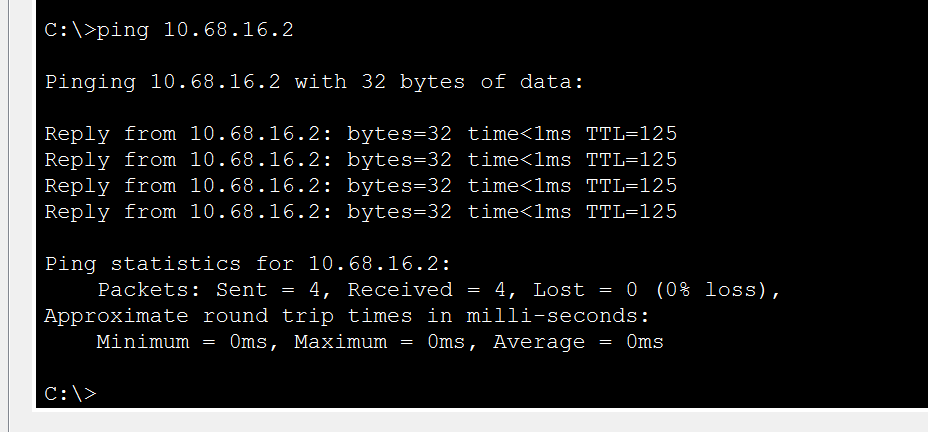

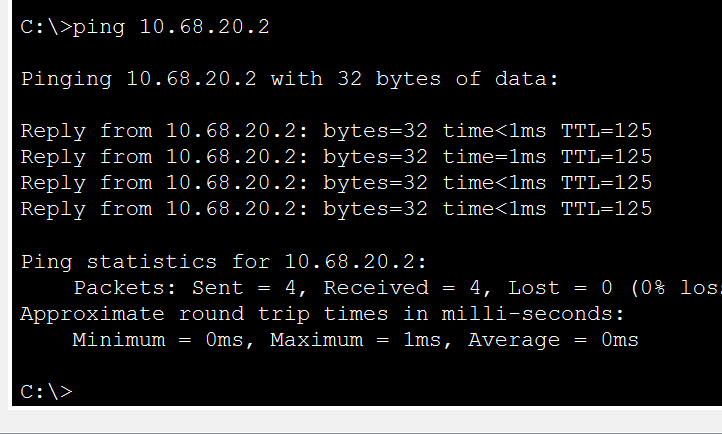

### JJ ke Chisa dan Semi
Untuk mencoba jalur yang lebih jauh, JJ melakukan ping ke Chisa (`10.68.22.130`) dan Semi (`10.68.23.2`). Hasil keduanya 4 reply dan 0% loss.

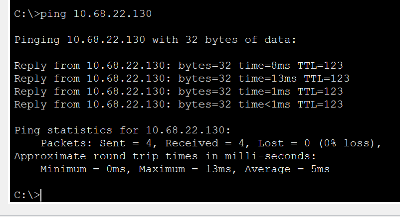

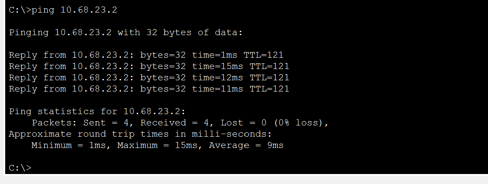

### Reika ke Akashic
Pengujian lain dilakukan dari Reika (`10.68.16.3`) ke Akashic (`10.68.10.74`). Ping kedua berhasil menerima 4 paket tanpa packet loss.

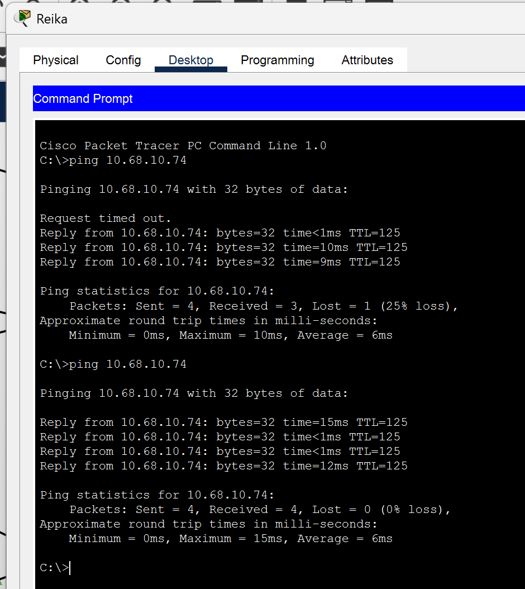

Pengujian di atas menunjukkan beberapa cabang sudah dapat saling terhubung. Namun, yang didokumentasikan baru beberapa contoh ping, belum pengujian satu per satu untuk semua pasangan node.

---

## 10. Kesimpulan
Pada Cisco Packet Tracer, IP untuk 25 subnet sudah dimasukkan sesuai tabel CIDR dan setiap router dikonfigurasi menggunakan static routing. Dari beberapa ping yang dilakukan, komunikasi antarcabang berhasil. Contohnya Karl dengan Lain, JJ ke beberapa host di cabang berbeda, serta Reika ke Akashic.

Pengujian yang ditampilkan masih berupa beberapa sampel ping. Koneksi eksternal lewat Cloud juga belum diuji, jadi belum dimasukkan sebagai hasil pengujian.

Berkas simulasi dan pembagian IP: [Cisco Packet Tracer (.pkt)](https://drive.google.com/file/d/1mExQTLCAiR4GjSxOQW_UHOaMVAjuF97K/view) dan [spreadsheet CIDR](https://docs.google.com/spreadsheets/d/1_XzT5qJeQtYygXIKjYKCix1CHkUHeK53sgwfx0uzLeM/edit).


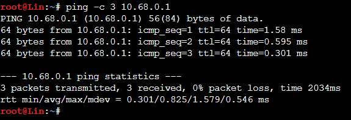

---

